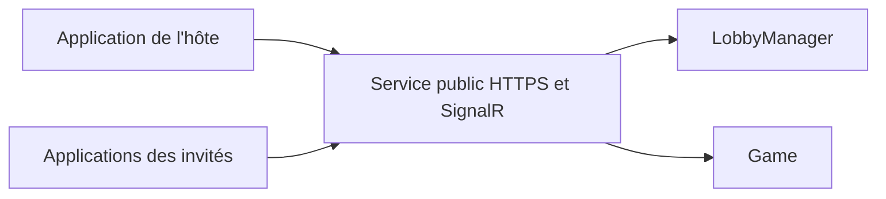

# TheGang-Online

Prototype d'application bureau pour **The Gang**, avec une logique de jeu indépendante de l'interface WPF.

## Ce qui fonctionne aujourd'hui

Le moteur peut exécuter une partie complète du **jeu de base** en mémoire, du premier braquage jusqu'à la victoire ou la défaite. Les tests couvrent aussi le cas d'une partie qui dure cinq braquages. L'application WPF ouvre encore une fenêtre vide : aucun parcours jouable n'est disponible dans l'interface. Les règles optionnelles (défis, spécialistes, variantes de difficulté) ne sont pas encore implémentées.

## État du moteur

Le projet `Model` couvre le jeu de base pour 3 à 6 joueurs : paquet standard de 52 cartes, distribution de deux cartes privées, révélation du flop, du turn et de la river, jetons des quatre couleurs, classement des mains de Texas Hold'em et résolution des braquages. Une main à égalité avec la précédente est acceptée. La partie se termine après trois braquages réussis ou trois échecs.

Les jetons peuvent être pris au centre, repris à un autre joueur ou rendus jusqu'à l'accord de tous. La confirmation ne commence que lorsque `AllPlayersHaveTokens` est vrai. Chaque joueur confirme alors son choix avec `ConfirmChoice`. Si un jeton change de propriétaire ou retourne au centre, toutes les confirmations sont annulées. Un joueur peut aussi retirer sa confirmation pour rouvrir les échanges. Les jetons des tours précédents restent visibles par joueur dans `Player.Signals` et `PlayerViewModel.Signals`. `Game` est la seule classe qui modifie les mains, les cartes communes et l'attribution des jetons.


## Lobby local

`LobbyManager` crée un lobby avec un code aléatoire de six caractères et une capacité choisie entre 3 et 6 joueurs, hôte compris. `JoinLobby` inscrit un joueur à partir de ce code, `LeaveLobby` libère une place et `StartGame` lance la partie uniquement à la demande de l'hôte et avec au moins trois joueurs. L'hôte peut fermer le lobby avec `CloseLobby`. Les noms sont uniques dans chaque lobby.

Ce registre fonctionne uniquement **dans le processus qui l'a créé**. Le code permet d'y retrouver une partie dans ce registre, mais ne localise pas à lui seul un ordinateur sur Internet. Le lobby local n'est donc pas encore accessible depuis une autre machine.

## Cible réseau : rejoindre depuis n'importe quel réseau

Le joueur « hôte » créera et contrôlera le lobby, sans devoir ouvrir un port sur sa box. Toutes les applications bureau se connecteront à **un même service public** en HTTPS. Ce service conservera les lobbies et les parties, recevra le code d'invitation, puis diffusera les changements de joueurs et de jetons en temps réel. Une couche ASP.NET Core avec SignalR convient à ces échanges ; elle n'est pas encore implémentée.



Le code reste une invitation, pas une preuve d'identité. Le service devra rattacher chaque connexion à un joueur, réserver à l'hôte les actions de démarrage et de fermeture, et envoyer à chaque client uniquement les cartes qu'il est autorisé à voir. `LobbyManager` et `Game` resteront côté service. Un registre en mémoire suffit pour un premier prototype sur un seul serveur ; sa perte au redémarrage et les reconnexions devront être traitées avant une mise en production.

## Utilisation du modèle

Créer un `Game`, ajouter 3 à 6 joueurs avec `AddPlayer`, puis appeler `StartGame`. Pour chaque tour, utiliser `TakeToken(playerId, value)` jusqu'à ce que chaque joueur possède un jeton, puis recueillir les confirmations avec `ConfirmChoice(playerId)`. `AllChoicesConfirmed` doit être vrai pour avancer avec `RevealFlop`, `RevealTurn`, `RevealRiver` ou `GoToShowdown`.

Pendant le showdown, `NextPlayerToRevealId` désigne le prochain joueur dans l'ordre des jetons rouges. Chaque appel à `RevealNextHand` dévoile exactement cette main et l'ajoute à `RevealedHands`. Une fois toutes les mains dévoilées, `ResolveHeist` retourne le succès du braquage et met à jour le score. Si `Phase` vaut `HeistComplete`, `StartNextHeist` démarre le suivant. Si elle vaut `Finished`, `Result` indique la victoire ou la défaite.

`GameViewModel` expose ces opérations et les propriétés utiles à une future interface. Il peut recevoir l'identifiant du joueur local à sa création : sa main lui est visible, tandis que celles des autres joueurs ne deviennent visibles qu'après `RevealNextHand`. Sans identifiant local, seules les mains dévoilées sont visibles. Le modèle `Game` reste l'état de confiance qui contient toutes les cartes ; une future couche réseau devra envoyer à chaque client uniquement sa projection autorisée. L'affichage n'est pas traité à ce stade.

## Vérification

```powershell
dotnet test TheGang/TheGang.sln
dotnet build TheGang/View/View.csproj
```
