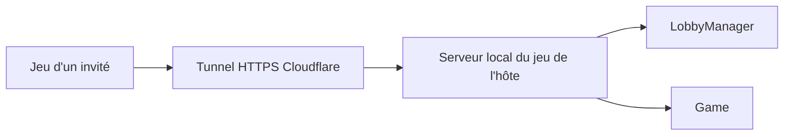

# TheGang-Online

Prototype d'application bureau pour **The Gang**, avec une logique de jeu indépendante de l'interface WPF.

## Ce qui fonctionne aujourd'hui

Le moteur peut exécuter une partie complète du **jeu de base**, du premier braquage jusqu'à la victoire ou la défaite. Les tests couvrent aussi le cas d'une partie qui dure cinq braquages. L'application WPF propose un menu, un lobby et une table de jeu pour 3 à 6 joueurs. Les règles optionnelles (défis, spécialistes, variantes de difficulté) ne sont pas encore implémentées.

## État du moteur

Le projet `Model` couvre le jeu de base pour 3 à 6 joueurs : paquet standard de 52 cartes, distribution de deux cartes privées, révélation du flop, du turn et de la river, jetons des quatre couleurs, classement des mains de Texas Hold'em et résolution des braquages. Une main à égalité avec la précédente est acceptée. La partie se termine après trois braquages réussis ou trois échecs.

Les jetons peuvent être pris au centre, repris à un autre joueur ou rendus jusqu'à l'accord de tous. La confirmation ne commence que lorsque `AllPlayersHaveTokens` est vrai. Chaque joueur confirme alors son choix avec `ConfirmChoice`. Si un jeton change de propriétaire ou retourne au centre, toutes les confirmations sont annulées. Un joueur peut aussi retirer sa confirmation pour rouvrir les échanges. Les jetons des tours précédents restent visibles par joueur dans `Player.Signals` et `PlayerViewModel.Signals`. `Game` est la seule classe qui modifie les mains, les cartes communes et l'attribution des jetons.


## Lobby local

`LobbyManager` crée un lobby avec un code aléatoire de six caractères et une capacité choisie entre 3 et 6 joueurs, hôte compris. `JoinLobby` inscrit un joueur à partir de ce code, `LeaveLobby` libère une place et `StartGame` lance la partie uniquement à la demande de l'hôte et avec au moins trois joueurs. L'hôte peut fermer le lobby avec `CloseLobby`. Les noms sont uniques dans chaque lobby.

Ce registre reste dans **le processus de l'hôte**. La couche réseau y accède via un serveur HTTP local dont les commandes sont liées à l'identité du joueur connecté.

## Jouer depuis différents réseaux

Chaque joueur saisit un pseudo. L'hôte choisit une capacité de 3 à 6 joueurs et clique sur **Créer un lobby**. Le jeu démarre un serveur HTTP sur `127.0.0.1` et lance `cloudflared.exe`, qui crée un tunnel HTTPS sortant sans ouverture de port ni compte utilisateur. Les invités collent le code d'invitation affiché par l'hôte puis choisissent leur pseudo. Le serveur refuse les pseudos vides, trop longs ou déjà pris dans ce lobby. La liste des joueurs est actualisée automatiquement toutes les deux secondes.

L'invitation à copier-coller a la forme `ABC234@nom-du-tunnel#SECRET`. Elle contient le code aléatoire à six caractères du lobby, le sous-domaine temporaire Cloudflare et un secret aléatoire de 128 bits. **Le code local seul ne suffit pas à rejoindre un hôte distant** : un annuaire public serait nécessaire pour le traduire en adresse de tunnel. L'invitation complète fonctionne sans annuaire.

Si l'hôte ferme l'application ou devient injoignable, les invités reviennent automatiquement à l'écran d'accueil avec un message court. Le jeu vérifie l'état du lobby toutes les deux secondes.

## Interface de jeu

Le menu permet d'héberger, de rejoindre ou de quitter le jeu. Le panneau **Paramètres** propose le mode fenêtré ou plein écran ainsi que l'activation des animations du plateau. **F11** change aussi le mode d'affichage ; **Échap** ferme les paramètres ou quitte le plein écran. L'hôte choisit la capacité du lobby avec les boutons 3 à 6 joueurs, puis lance la partie quand au moins trois joueurs sont présents. Les confirmations et erreurs s'affichent dans un bandeau visible en haut de l'écran.

Pendant la partie, le joueur local est en bas du tapis et les autres joueurs sont répartis autour de la table. Leurs cartes restent face cachée jusqu'à la révélation autorisée par le serveur. Pour prendre un jeton, glissez-le depuis le centre vers votre main ; pour reprendre un jeton, glissez celui d'un autre joueur. Vous pouvez rendre votre jeton en le ramenant au centre ou avec **Rendre**. Les jetons sont recadrés sur leur cercle et leur chiffre est centré dans un médaillon sombre bordé d'or. Une plaque sous chaque main indique le choix ou la confirmation ; quatre points colorés rappellent les tours dont les jetons sont déjà connus. Le tableau latéral indique les valeurs exactes des jetons par joueur et peut être masqué pour agrandir le tapis. Une petite carte **Aide de jeu** reste près de votre main : cliquez dessus pour consulter les quatre tours et les dix combinaisons de poker sur une seule page, sans défilement. Les faces des cartes sont dessinées en vecteurs avec leurs indices, les enseignes répétées des cartes numérotées et des figures doubles pour le valet, la dame et le roi.

Pendant qu'un joueur glisse un jeton, les autres voient sa position et son pseudo sur le tapis. Le client envoie des positions temporaires à l'hôte ; seul le dépôt sur la main applique la prise ou la reprise au moteur. Chaque prise, reprise et révélation est ordonnée par l'hôte et inscrite dans le journal des actions. Le plateau est actualisé toutes les 500 ms pendant une partie, et toutes les 200 ms lorsqu'un glissement distant est en cours. Les délais du réseau peuvent décaler légèrement ce mouvement. À chaque passage au flop, au turn, à la river ou à la révélation finale, une annonce colorée apparaît sur le tapis ; les nouvelles cartes communes se retournent dans l'ordre et les jetons du nouveau tour apparaissent. La place du prochain joueur à révéler est mise en évidence. En haut, six cartes sont face cachée : chaque braquage réussi retourne une carte d'or et chaque échec une carte d'alarme. Une alarme rouge scintille après un échec ; le coffre ne s'ouvre qu'à la troisième carte d'or. Le panneau de résultat se ferme avec **Continuer** ou **Échap** ; il disparaît automatiquement après huit secondes pour un braquage intermédiaire, mais reste visible en fin de partie. Les cartes de score se retournent après sa fermeture. Les commandes de l'hôte et des invités occupent la même hauteur de pied de page. La désactivation des animations conserve les annonces et les images finales, sans mouvements. Le curseur du jeu utilise un gant en laine noir.

**Quitter la partie** après son démarrage ferme le lobby pour tous : le moteur ne peut pas continuer un braquage avec un joueur manquant. Les autres joueurs reviennent automatiquement à l'accueil. Les images du tapis, du dos des cartes, des jetons, des deux états du coffre, des cartes d'or et d'alarme, du logo de la boîte et du gant sont intégrées comme ressources dans `View/Assets`.



À l'inscription, le serveur crée un jeton de session opaque propre au joueur. Toutes les commandes suivantes exigent ce jeton ; le client ne peut pas choisir l'identifiant du joueur au nom duquel il agit. Seul l'hôte peut démarrer la partie et déclencher les révélations. Chaque réponse de jeu est reconstruite pour le destinataire : sa main privée est visible, les mains adverses restent cachées jusqu'à leur révélation, les jetons actuels et précédents sont publics.

Cette version utilise les **Quick Tunnels**, que Cloudflare destine aux essais et au développement. L'adresse change à chaque création et leur disponibilité n'est pas garantie. La partie s'arrête lorsque l'hôte ferme le jeu ou perd sa connexion. Les sessions et l'état de jeu sont en mémoire ; une reconnexion après fermeture du processus hôte n'est pas encore possible. Une diffusion durable demandera une solution de tunnel ou de relais avec garanties adaptées.

## Préparer un exécutable Windows autonome

Depuis la racine du dépôt :

```powershell
./TheGang/publish-windows.ps1
```

Le script publie l'application avec le runtime .NET, télécharge la version épinglée de `cloudflared.exe`, vérifie sa somme SHA-256 et place les deux exécutables dans `TheGang/artifacts/win-x64`. Distribuer **tout le dossier** : les joueurs lancent `View.exe` sans installer le tunnel séparément. En développement depuis Visual Studio, placer `cloudflared.exe` à côté de `View.exe` ou sur le `PATH` si l'on veut créer un lobby.

## Utilisation du modèle

Créer un `Game`, ajouter 3 à 6 joueurs avec `AddPlayer`, puis appeler `StartGame`. Pour chaque tour, utiliser `TakeToken(playerId, value)` jusqu'à ce que chaque joueur possède un jeton, puis recueillir les confirmations avec `ConfirmChoice(playerId)`. `AllChoicesConfirmed` doit être vrai pour avancer avec `RevealFlop`, `RevealTurn`, `RevealRiver` ou `GoToShowdown`.

Pendant le showdown, `NextPlayerToRevealId` désigne le prochain joueur dans l'ordre des jetons rouges. Chaque appel à `RevealNextHand` dévoile exactement cette main et l'ajoute à `RevealedHands`. Une fois toutes les mains dévoilées, `ResolveHeist` retourne le succès du braquage et met à jour le score. Si `Phase` vaut `HeistComplete`, `StartNextHeist` démarre le suivant. Si elle vaut `Finished`, `Result` indique la victoire ou la défaite.

`GameViewModel` expose ces opérations pour les usages locaux. Il peut recevoir l'identifiant du joueur local à sa création : sa main lui est visible, tandis que celles des autres joueurs ne deviennent visibles qu'après `RevealNextHand`. Le modèle `Game` reste l'état de confiance qui contient toutes les cartes ; la couche `Network` crée ses propres DTO pour ne jamais sérialiser directement ce modèle vers les invités.

## Vérification

```powershell
dotnet test TheGang/TheGang.sln
dotnet build TheGang/View/View.csproj
```

Pour tester en plus le tunnel public réel (nécessite l'accès à Cloudflare) :

```powershell
$env:THEGANG_CLOUDFLARED = (Resolve-Path 'TheGang/artifacts/win-x64/cloudflared.exe').Path
dotnet test TheGang/UnitTests/UnitTests.csproj --filter FullyQualifiedName~QuickTunnelAllowsJoiningFromItsPublicAddress
```
